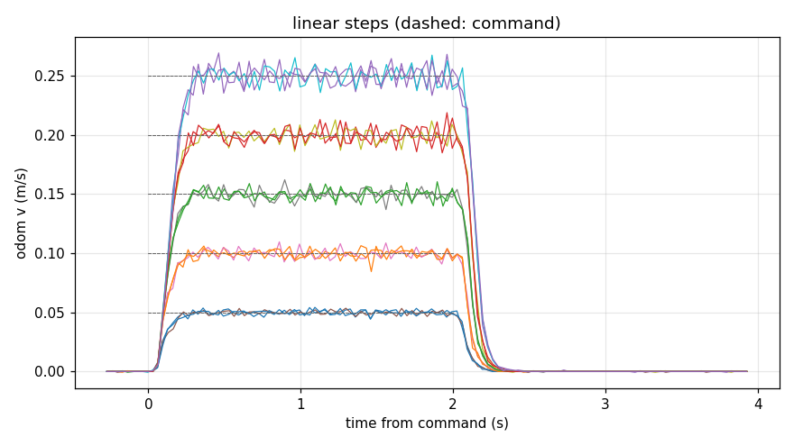
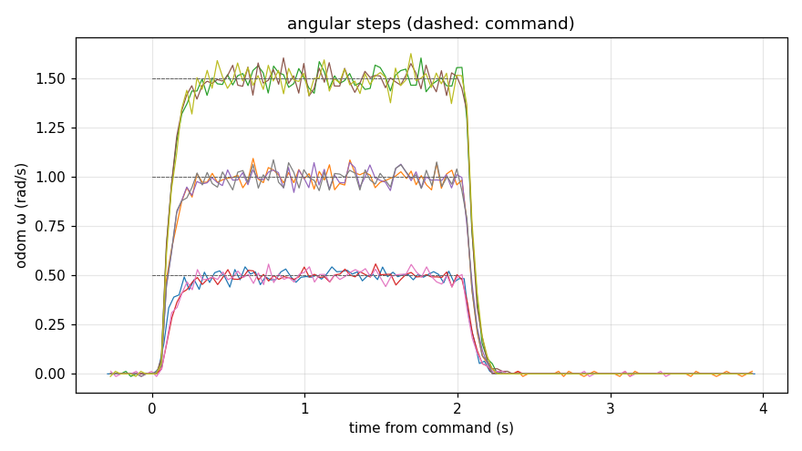
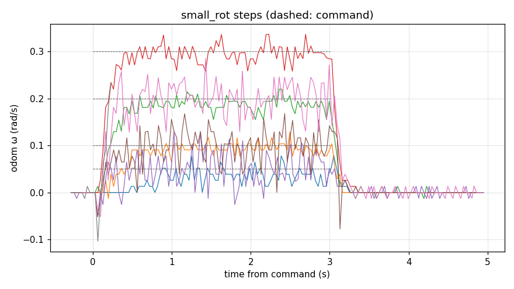

# cmd_vel 계단 응답

입력: step_angular_pode2.csv, step_linear_pode2.csv, step_small_rot_pode2.csv

## 계단 응답

| set | label | 반복 | 지연 s | 상승 s | 정상 비 | 최대 가속 | 최대 감속 |
|---|---|---|---|---|---|---|---|
| angular | w0.50 | 1 | 0.049 | 0.146 | 1.003 | 4.63 | 4.72 |
| linear | v0.05 | 1 | 0.061 | 0.125 | 1.002 | 0.47 | 0.43 |
| angular | w1.00 | 1 | 0.066 | 0.140 | 0.995 | 8.94 | 8.49 |
| linear | v0.10 | 1 | 0.065 | 0.125 | 0.995 | 0.87 | 1.15 |
| angular | w1.50 | 1 | 0.066 | 0.150 | 0.996 | 13.42 | 13.22 |
| linear | v0.15 | 1 | 0.070 | 0.154 | 0.999 | 1.25 | 1.29 |
| linear | v0.20 | 1 | 0.072 | 0.158 | 0.998 | 1.28 | 1.76 |
| linear | v0.25 | 1 | 0.078 | 0.155 | 1.000 | 1.70 | 1.91 |
| angular | w0.50 | 2 | 0.069 | 0.181 | 0.996 | 3.82 | 3.99 |
| angular | w1.00 | 2 | 0.066 | 0.138 | 0.996 | 8.54 | 8.05 |
| angular | w1.50 | 2 | 0.065 | 0.136 | 0.996 | 13.36 | 14.77 |
| linear | v0.05 | 2 | 0.060 | 0.136 | 0.996 | 0.41 | 0.43 |
| linear | v0.10 | 2 | 0.064 | 0.127 | 0.991 | 0.93 | 0.96 |
| linear | v0.15 | 2 | 0.069 | 0.132 | 0.999 | 1.16 | 1.22 |
| linear | v0.20 | 2 | 0.073 | 0.146 | 0.998 | 1.38 | 1.66 |
| linear | v0.25 | 2 | 0.077 | 0.169 | 0.999 | 1.44 | 1.77 |
| angular | w0.50 | 3 | 0.069 | 0.150 | 0.997 | 4.35 | 4.82 |
| angular | w1.00 | 3 | 0.066 | 0.167 | 0.996 | 8.78 | 8.34 |
| angular | w1.50 | 3 | 0.067 | 0.129 | 0.994 | 13.38 | 14.09 |
| linear | v0.05 | 3 | 0.064 | 0.147 | 0.996 | 0.50 | 0.49 |
| linear | v0.10 | 3 | 0.065 | 0.130 | 0.996 | 0.85 | 1.00 |
| linear | v0.15 | 3 | 0.069 | 0.145 | 0.999 | 1.14 | 1.25 |
| linear | v0.20 | 3 | 0.073 | 0.160 | 0.998 | 1.39 | 1.71 |
| linear | v0.25 | 3 | 0.078 | 0.190 | 1.000 | 1.53 | 1.80 |

평균(반복 묶음):

| set | label | 지연 s | 상승 s | 정상 비 | 최대 가속 | 최대 감속 |
|---|---|---|---|---|---|---|
| angular | w0.50 | 0.062 | 0.159 | 0.999 | 4.27 | 4.51 |
| linear | v0.05 | 0.061 | 0.136 | 0.998 | 0.46 | 0.45 |
| angular | w1.00 | 0.066 | 0.148 | 0.996 | 8.75 | 8.29 |
| linear | v0.10 | 0.065 | 0.127 | 0.994 | 0.88 | 1.04 |
| angular | w1.50 | 0.066 | 0.138 | 0.995 | 13.39 | 14.03 |
| linear | v0.15 | 0.070 | 0.144 | 0.999 | 1.18 | 1.25 |
| linear | v0.20 | 0.073 | 0.155 | 0.998 | 1.35 | 1.71 |
| linear | v0.25 | 0.078 | 0.171 | 1.000 | 1.55 | 1.83 |

가속 단위: linear는 m/s², angular는 rad/s². 지연은 명령에서 odom이 목표의 10%에 닿기까지, 상승은 10%에서 90%까지. 둘 다 명령을 내는 동안에서만 찾고, 그 안에 닿지 못하면 미도달(평균은 한 번이라도 못 닿으면 미도달).

## 작은 회전(데드밴드)

| v | ω 명령 | 평균 ω 비 |
|---|---|---|
| 0.00 | 0.05 | 0.724 |
| 0.00 | 0.10 | 0.942 |
| 0.00 | 0.20 | 0.931 |
| 0.00 | 0.30 | 0.990 |
| 0.12 | 0.05 | 1.065 |
| 0.12 | 0.10 | 0.980 |
| 0.12 | 0.20 | 1.007 |
| 0.12 | 0.30 | 0.689 |

- v=0.00: 반응하는 가장 작은 ω = 0.05 rad/s (평균 비 ≥ 0.5)
- v=0.12: 반응하는 가장 작은 ω = 0.05 rad/s (평균 비 ≥ 0.5)

